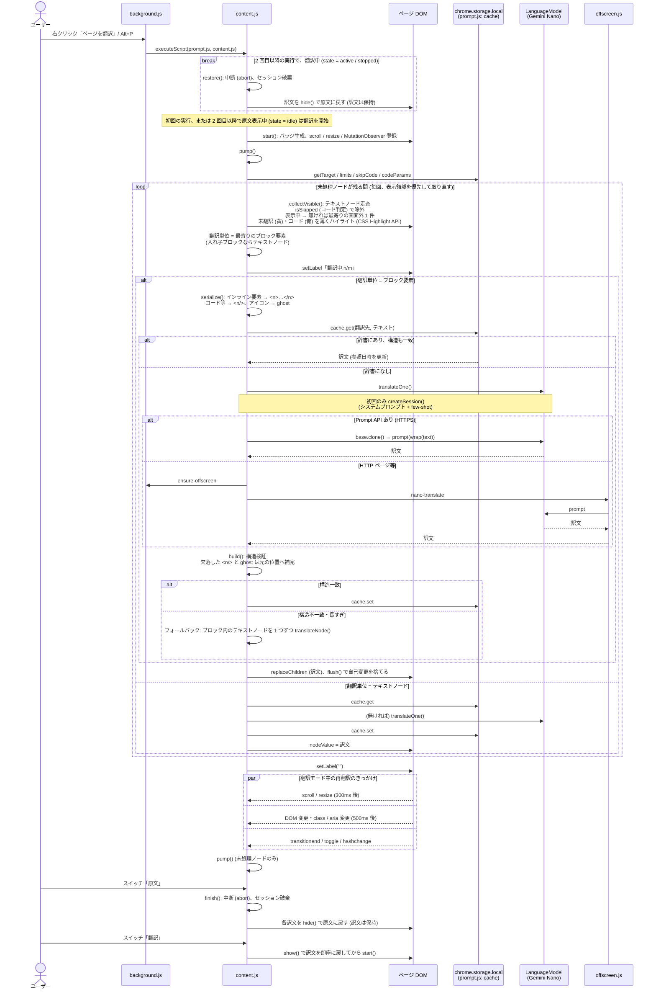
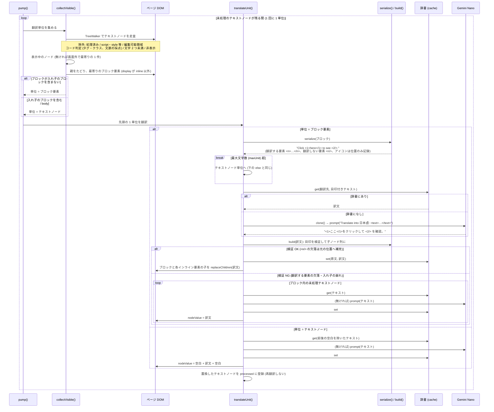

# Nano Translate

# 概要

Chrome で表示した Web ページ・選択テキスト・任意の入力文を翻訳する拡張機能。
Chrome 内蔵の Gemini Nano を使用。翻訳はブラウザ内で完結し、外部サーバと通信しない。

- 翻訳先: 日本語 / English / Español / Deutsch / Français (Prompt API の出力対応言語)
- 翻訳済みの原文・訳文は端末内 (`chrome.storage.local`) に辞書として保存。同一の原文・翻訳先は再翻訳せず辞書の訳文を使用

# 環境

- OS: Windows 10/11、macOS 13+、Linux、ChromeOS (Chromebook Plus)
- 空き容量: Chrome プロファイルのあるボリュームに 22GB 以上 (ダウンロード後に 10GB 未満になるとモデル削除)
- GPU: VRAM 4GB 超、または CPU: RAM 16GB 以上かつ 4 コア以上
- 従量制でない通信 (初回のモデルダウンロードのみ)
- Chrome 138 以降

# インストール

1. `chrome://extensions` を開き、デベロッパー モードを ON
2. 「パッケージ化されていない拡張機能を読み込む」でこのディレクトリ(`Translate/`) を選択
3. 初回の翻訳時にモデルを自動取得 (数分〜数十分)。進捗はバッジ / ポップアップに「モデル取得中 n%」と表示

# 操作一覧

| 操作 | 動作 |
| --- | --- |
| ツールバーのアイコン / `Alt+T` | 翻訳ポップアップを開く |
| `Alt+P` | 表示中のページを翻訳 / 元に戻す |
| 右クリック「ページを Gemini Nano で翻訳 / 元に戻す」 | ページ翻訳 |
| 右クリック「Gemini Nano で翻訳: "選択文"」 | 小ウィンドウで選択範囲を翻訳 |

ショートカットは `chrome://extensions/shortcuts` で変更可能。

# 表示中のWebページを翻訳する手順

*1. 翻訳したいページを開く
2. 次のいずれかを実行*
   - `Alt+P`
   - ページ上で右クリック → 「ページを Gemini Nano で翻訳 / 元に戻す」
3. 画面右下にバッジが表示され、表示領域 (viewport) 内のテキストをその場で訳文に置換
   - スクロール・リサイズで新たに見えた部分は追加で翻訳
   - 未翻訳 (処理待ち・訳せなかった) テキストは薄い黄色、コードと判定して翻訳しない部分は薄い青でハイライト (未翻訳は既定 ON、コードは既定 OFF。設定で切り替え)
   - `script` / `style` / `textarea` / `input` / `code` / `pre` 等は翻訳対象外
4. バッジの操作
   - [原文]( o)[翻訳] のスイッチで翻訳と原文を切り替え
   - 未翻訳状態で[翻訳]が選択されたら進捗を表示する
   - ⚙️: 設定ページを開く
   - x : バッジを閉じる
   - ドラッグで移動
5. 元に戻す: 再度 `Alt+P` (または同メニュー)

HTTP ページ (非セキュアコンテキスト) では content script から Prompt API を使えない。拡張の offscreen document に中継して翻訳する。

# ページ翻訳の処理の流れ

- 処理済みのテキストノードは `processed` に記録し、再翻訳しない
- エラー時は `stopped` にして自動翻訳を停止 (翻訳済み部分は残す)

## 翻訳部分 (翻訳単位の切り出し → AI 翻訳 → 置換)

# 選択テキスト / 任意の文章を翻訳する手順

- 選択範囲: テキストを選択 → 右クリック → 「Gemini Nano で翻訳」。小ウィンドウで即翻訳
- 任意の文章: ポップアップ (`Alt+T`) に入力 → `Ctrl+Enter` または「翻訳」
  - 原文の言語は自動検出 (`LanguageDetector` 対応時)
  - 「停止」で中断、「コピー」で訳文をコピー

# 設定

ポップアップ右上の ⚙️ またはバッジの ⚙️ から設定ページを開く。

- 翻訳先言語: 既定はブラウザの言語設定 (UI 言語 → 受け入れ言語の順で最初の対応言語。全て非対応なら English)。ポップアップで翻訳先を変えると設定も更新
- ページ翻訳: ソースコードを翻訳しない (既定 ON)、未翻訳のテキストを薄く黄色でハイライト (既定 ON)、コードと判定した部分を薄く青でハイライト (既定 OFF)、デバッグ: 翻訳ブロックの詳細 (翻訳単位・状態・AI の入出力・目印の対応・コード判定) をホバー表示、AI で翻訳中の文言 (入力・生成中の出力) をリアルタイム表示 (既定 OFF)、1 回に AI で翻訳する最大文字数 (既定 2000。複数の翻訳単位を JSON 文字列配列にまとめて 1 回で翻訳)
- コード判定のパラメータ: 文脈からの推定の条件ごとの点数・基準値・しきい値・等幅フォント名・キーワード (既定値に戻す)。入力テキストを採点する試算つき
- 辞書 (翻訳キャッシュ): 保存上限・保存する原文の最大文字数、絞り込み、訳文の編集 (以後の翻訳に反映)、項目削除、全件クリア
